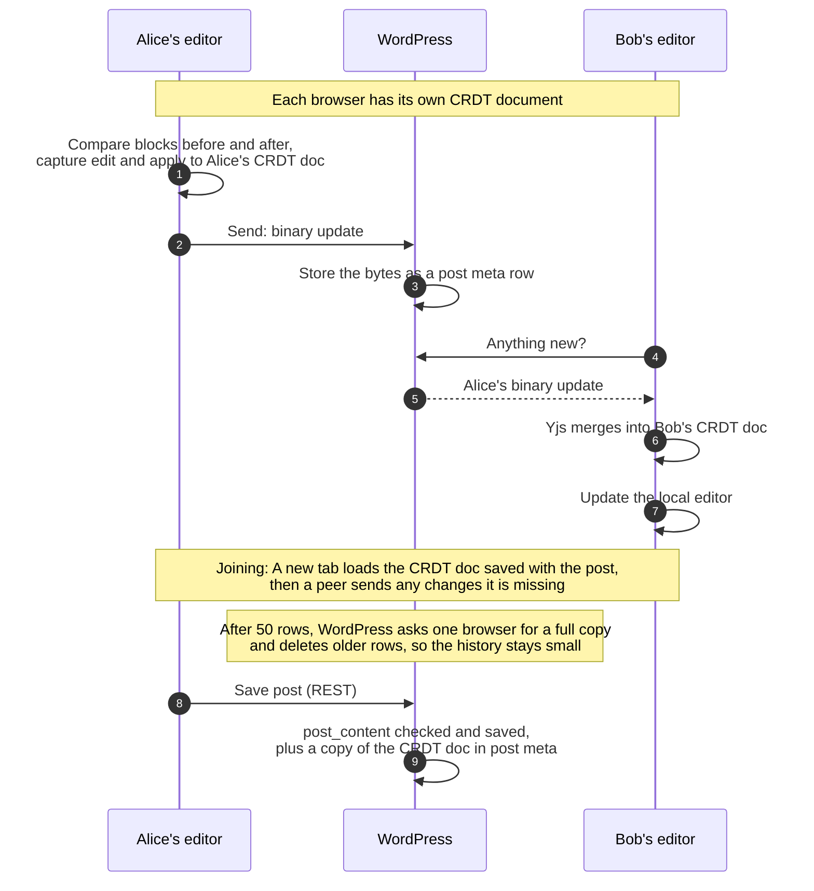
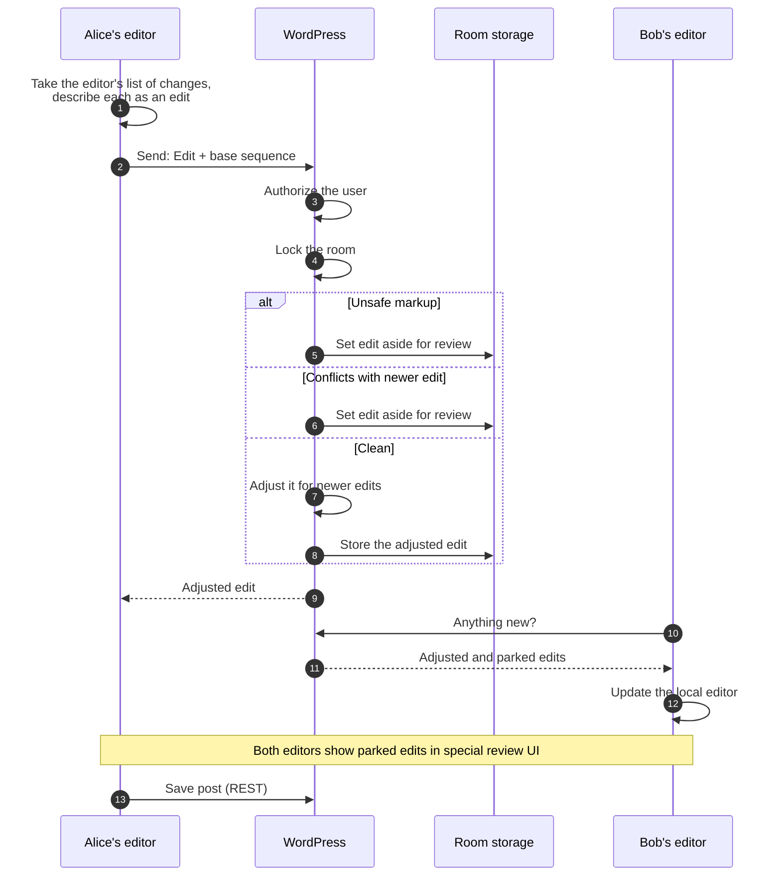

# Data flow

This page shows how one person's update reaches everyone else during
collaborative editing. It covers today's Gutenberg experiment
(including the WPVIP WebSocket transport, which can stand in for its
polling) and what this plugin proposes.

## Short version

In the Gutenberg experiment, **browsers merge updates and WordPress
is just a relay**. WordPress stores the updates as bytes, but cannot
read them, validate them, sanitize them, or notice that two people
changed the same thing. It is only aware of how the content has changed
when someone saves the post.

This plugin proposes that **WordPress takes part in every update**. The
server receives each edit, checks who sent it and what it contains,
merges it, and stores the result. Other browsers then receive what the
server accepted. The plugin ships one engine, intent-log, which does
the merging. The engine choice and the transport choice are
separate: the engine runs over either transport.

|                                             | Gutenberg experiment                | This plugin                                                                |
| ------------------------------------------- | ----------------------------------- | -------------------------------------------------------------------------- |
| Who merges                                  | Browsers                            | WordPress                                                                  |
| What WordPress can read                     | Nothing until the post is saved     | Every edit as it arrives                                                   |
| Markup safety checks (`kses`) on live edits | None                                | Every edit as it arrives                                                   |
| Same-spot conflicts                         | Settled silently                    | Set aside for review                                                       |
| How edits travel                            | Short polling, or WPVIP's WebSocket | Short polling, or WebSocket                                                |
| Where edits are stored                      | Post meta on a custom post type     | Two custom tables                                                          |

A **room** is one shared document, usually a post. A **row** is one
stored entry in a room's history. Every browser remembers the last row
it has seen, and asks for the rows after it.

## Block editor data flow

### Gutenberg experiment

Each browser keeps its own copy of the post as a CRDT (Yjs) document.
Browsers send Yjs updates (binary data) to WordPress. WordPress stores
them and relays them to the other browsers, which merge them into their
copy.

If you'd like a more detailed breakdown of the data flow, see the
[step-by-step](#one-keystroke-step-by-step) section below.

What this means:

-   The server is a relay. It cannot reject unsafe markup, enforce
    per-block rules, or tell a real conflict from a clean merge.
-   Content is checked only when someone saves the post. Until then, a
    user who can edit the post can push any block content into the other
    editors.
-   Two people changing the same thing at once do not see a conflict. Yjs
    merges the changes silently. For single values, one edit wins (chosen
    by client ID, not by time). For text, both people's typing is kept.

**The WPVIP WebSocket transport** works the same way: a separate
Node.js server relays Yjs updates between browsers and stores nothing,
so WordPress still sees the content only when the post is saved.

### This plugin, intent-log engine

The browser turns each change into a small, readable description, such
as "insert 'x' at position 4 in paragraph 2". Each description records
which point in the history it was made against (base sequence).
WordPress handles one edit at a time for each post. If newer edits
exist, it adjusts the edit so that it merges cleanly. If it cannot
adjust an edit safely, it sets it aside for a human to review.

## Transports

A transport is how updates travel; the engine runs over either one.
Short polling is the base: the editor asks WordPress for new rows on a
timer, and a side channel between the tabs on one post (the advisory
channel) tells a tab when to ask, so an idle room makes almost no
requests. The sync daemon's WebSocket pushes rows
instead. The table of what each costs and needs is in
[transports.md](transports.md).

## One keystroke, step by step

The first and last steps are the same for the Gutenberg experiment and
for this plugin.

1. The user types. Rich text updates the block's `content` attribute,
   `useBlockSync` passes the change to core-data, and
   `editEntityRecord` hands the edit to the sync provider right before
   it stores it. (This ordering is the trap in
   the Traps section of `AGENTS.md`: a push made from inside that call is
   overwritten.)
2. The engine records the edit. The experiment writes it
   into the Yjs document and queues the binary update. For this plugin,
   core-data hands over an ordered list of what changed: this block
   was inserted here, this attribute went from one value to another.
   Intent-log turns each entry into a typed edit
   (`src/editor/capture.ts`) and applies it locally. It does not
   compare block trees to find out what changed.
3. The edit travels. The experiment sends its queue on the next
   poll. Intent-log keeps every edit the server has not answered in
   one list, and the transport asks for what to send: on the next poll,
   or at once over an open socket. A tab that is alone sends at most
   once per polling interval. [room-state.md](room-state.md) has the
   list and its rules.
4. A peer receives. The experiment merges the update into its Yjs
   document.
   Intent-log adds the rows to its local history and recomputes its
   own pending edits on top, then pushes the merged block list once
   typing pauses.
5. The merged blocks reach the editor as a local `EDIT_ENTITY_RECORD`
   that skips the sync provider, so it is not sent back and stays out of
   the peer's undo history. `useBlockSync` replaces the blocks and rich
   text updates the page.
